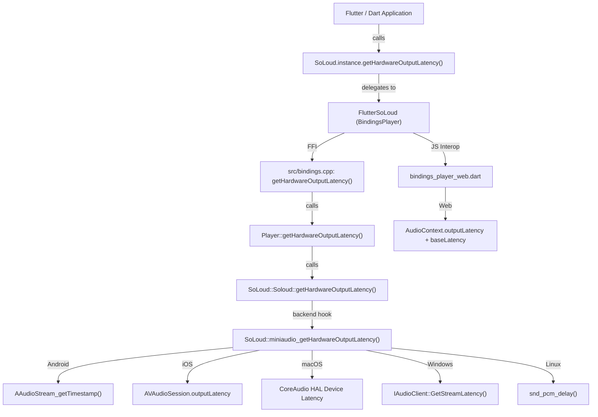

# Architectural Plan: `getHardwareOutputLatency()` Support

**Reference Issue:** [alnitak/flutter_soloud#587](https://github.com/alnitak/flutter_soloud/issues/587)  
**Target Method:** `Duration getHardwareOutputLatency()`  
**Target Location:** `lib/src/soloud.dart` (directly following `getOutputLatency()`)

---

## 1. Problem Statement & Motivation

In audio-synchronized applications (such as multi-device click sync, rhythm games, DAWs, metronomes, and video-audio alignment), an app must know the exact instant when an audio sample actually leaves the physical transducer (speakers, headphones, Bluetooth receiver).

Currently, `flutter_soloud` exposes `getOutputLatency()`:
```dart
Duration getOutputLatency();
```
However, `getOutputLatency()` only measures the **internal software render-ahead ring depth** (`(buffered + devicePeriodFrames) / sampleRate`) inside SoLoud. Crucially:
1. When render-ahead is disabled (the default mode), `getOutputLatency()` returns `Duration.zero`.
2. It completely misses external physical delays:
   - Operating system audio server / HAL buffers.
   - DSP processing inside audio drivers.
   - DAC (Digital-to-Analog Converter) conversion stages.
   - Audio route delays (e.g. wired headphones, USB-C DACs, Bluetooth A2DP encoding/transceivers).

On Android, relying on `PROPERTY_OUTPUT_FRAMES_PER_BUFFER` (the HAL burst quantum) reports only a few milliseconds (~4–5 ms), but actual acoustic measurements with a physical microphone (e.g. on a Redmi Note 10 Pro) reveal that physical sound leaves the device **30–40 ms later**.

To bridge this gap, `flutter_soloud` needs a dedicated method:
```dart
Duration getHardwareOutputLatency();
```

---

## 2. Conceptual Model: `getOutputLatency()` vs `getHardwareOutputLatency()`

| Dimension | `getOutputLatency()` | `getHardwareOutputLatency()` |
| :--- | :--- | :--- |
| **Domain** | **Internal Software Pipeline** (Inside SoLoud) | **External Hardware Pipeline** (Outside SoLoud) |
| **What it measures** | Render-ahead ring buffer depth + 1 device period | OS mixer / HAL queue + driver DSP + DAC conversion + route buffer |
| **Default value** | `Duration.zero` (unless `renderAheadFrames` is enabled at init) | Dynamic `Duration` representing current hardware route delay |
| **Source of truth** | `mRenderRing.availableToRead()` in `soloud.cpp` | OS hardware presentation timestamps / driver queries |
| **Route-aware?** | No (same value regardless of route) | Yes (differs between speakers, USB-C DAC, Bluetooth) |

### Total Physical Ear-to-Speaker Latency
$$\text{Total Physical Latency} \approx \text{getOutputLatency()} + \text{getHardwareOutputLatency()}$$

* **If render-ahead is enabled:** `getOutputLatency()` covers the time samples wait in SoLoud's ring before entering the device buffer, while `getHardwareOutputLatency()` covers the time from the device buffer to the listener's ear.
* **If render-ahead is disabled (default):** `getOutputLatency()` is `0`, and `getHardwareOutputLatency()` represents the full delay between the miniaudio data callback and physical emission.

---

## 3. Miniaudio Latency Capabilities & Backend Access

### Does miniaudio provide a unified hardware latency API?
* **Converter Latency:** Miniaudio provides `ma_data_converter_get_output_latency(&pDevice->playback.converter)` which reports resampling/format conversion delay within miniaudio itself.
* **Buffer Allocation:** Miniaudio knows `pDevice->playback.internalPeriodSizeInFrames * pDevice->playback.internalPeriods`.
* **Hardware Presentation Timestamps:** Miniaudio does **not** provide a unified cross-backend presentation timestamp function (such as `ma_device_get_hardware_output_latency()`).

### How `flutter_soloud` interfaces with miniaudio:
In `src/soloud/src/backend/miniaudio/soloud_miniaudio.cpp`, `flutter_soloud` has full direct access to `ma_device gDevice` and `ma_context context`. The internal structures contain raw native backend stream pointers:
* `gDevice.backend` (e.g. `ma_backend_aaudio`, `ma_backend_wasapi`, `ma_backend_coreaudio`, `ma_backend_alsa`)
* `gDevice.aaudio.pStreamPlayback` (`AAudioStream*` on Android)
* `gDevice.wasapi.pAudioClientPlayback` (`IAudioClient*` on Windows)
* `gDevice.alsa.pPCMPlayback` (`snd_pcm_t*` on Linux ALSA)
* `gDevice.pulseaudio.pStreamPlayback` (`pa_stream*` on Linux PulseAudio)
* `context.aaudio.hAAudio` (`libaaudio.so` module handle dynamically loaded by miniaudio)

Therefore, `soloud_miniaudio.cpp` can implement `miniaudio_getHardwareOutputLatency()` natively for each backend without hacking miniaudio internals.

---

## 4. Platform-by-Platform Implementation Details

### 4.1. Android (AAudio backend)

On Android 8.0+ (API 26+), AAudio provides hardware presentation timestamps:
```c
aaudio_result_t AAudioStream_getTimestamp(
    AAudioStream* stream,
    clockid_t clockid,
    int64_t* framePosition,
    int64_t* timeNanoseconds
);
int64_t AAudioStream_getFramesWritten(AAudioStream* stream);
```

#### Calculation Formula:
Given:
- `framesWritten`: total frames written by the audio callback.
- `framePosition`: hardware frame position at presentation time `timeNanoseconds`.
- `timeNanoseconds`: timestamp in `CLOCK_MONOTONIC`.
- `nowNanoseconds`: current time from `clock_gettime(CLOCK_MONOTONIC)`.
- `sampleRate`: stream sample rate in Hz.

$$\text{Latency Seconds} = \frac{\text{framesWritten} - \text{framePosition}}{\text{sampleRate}} - \frac{\text{nowNanoseconds} - \text{timeNanoseconds}}{10^9}$$

#### Dynamic Linking / Loading:
Miniaudio loads `libaaudio.so` at runtime. We resolve function pointers:
```cpp
typedef aaudio_result_t (*pfn_AAudioStream_getTimestamp)(
    AAudioStream*, clockid_t, int64_t*, int64_t*);
typedef int64_t (*pfn_AAudioStream_getFramesWritten)(AAudioStream*);

static pfn_AAudioStream_getTimestamp gAAudioStream_getTimestamp = nullptr;
static pfn_AAudioStream_getFramesWritten gAAudioStream_getFramesWritten = nullptr;
```
During initialization (or on first call):
```cpp
if (context.aaudio.hAAudio != nullptr) {
    gAAudioStream_getTimestamp = (pfn_AAudioStream_getTimestamp)
        dlsym(context.aaudio.hAAudio, "AAudioStream_getTimestamp");
    gAAudioStream_getFramesWritten = (pfn_AAudioStream_getFramesWritten)
        dlsym(context.aaudio.hAAudio, "AAudioStream_getFramesWritten");
}
```

#### Android Fallback & Safety:
1. **Warm-up guard:** If the stream has not started or fewer than 1 buffer has processed, `AAudioStream_getTimestamp` returns an error or `framePosition == 0`. In this case, fallback to:
   $$\text{Fallback} = \frac{\text{internalPeriodSizeInFrames} \times \text{internalPeriods}}{\text{sampleRate}}$$
2. **OpenSL ES:** If running on OpenSL ES (legacy Android), fallback to the buffer period duration.
3. **Negative / Stale Clamp:** If the calculation yields $< 0$ (due to preemption/jitter), clamp to `0.0`.

---

### 4.2. iOS & iPadOS (AVFoundation / CoreAudio)

On Apple platforms, `src/soloud_miniaudio_objc.mm` compiles the backend as Objective-C++.

#### Implementation:
```objc
#if defined(__APPLE__) && defined(TARGET_OS_IPHONE) && TARGET_OS_IPHONE == 1
#import <AVFoundation/AVFoundation.h>

double getAppleHardwareOutputLatency() {
    AVAudioSession *session = [AVAudioSession sharedInstance];
    if (session == nil) return 0.0;
    // outputLatency includes active route hardware delay (AirPods/Bluetooth, speakers, USB DAC)
    // IOBufferDuration is the hardware audio buffer period
    NSTimeInterval total = session.outputLatency + session.IOBufferDuration;
    return total > 0.0 ? (double)total : 0.0;
}
#endif
```
`AVAudioSession.outputLatency` automatically adjusts when switching between built-in speakers, wired headphones, and Bluetooth (AirPods A2DP).

---

### 4.3. macOS (CoreAudio HAL)

On macOS desktop, `AVAudioSession` is not used; instead, CoreAudio HAL properties are queried on the active output device:
```cpp
#if defined(__APPLE__) && (!defined(TARGET_OS_IPHONE) || TARGET_OS_IPHONE == 0)
#include <CoreAudio/CoreAudio.h>

double getMacHardwareOutputLatency(ma_device *pDevice) {
    AudioDeviceID deviceID = ...; // active CoreAudio device
    UInt32 deviceLatency = 0;
    UInt32 safetyOffset = 0;
    UInt32 bufferFrames = pDevice->playback.internalPeriodSizeInFrames;
    Float64 sampleRate = pDevice->sampleRate;
    
    // Query kAudioDevicePropertyLatency
    // Query kAudioDevicePropertySafetyOffset
    return (double)(deviceLatency + safetyOffset + bufferFrames) / sampleRate;
}
#endif
```

---

### 4.4. Windows (WASAPI)

Miniaudio's default Windows backend is WASAPI.
In `pDevice->wasapi.pAudioClientPlayback`:
```cpp
#if defined(_WIN32)
#include <audioclient.h>

double getWasapiHardwareOutputLatency(ma_device *pDevice) {
    if (pDevice->backend != ma_backend_wasapi || !pDevice->wasapi.pAudioClientPlayback)
        return 0.0;
    IAudioClient *client = (IAudioClient*)pDevice->wasapi.pAudioClientPlayback;
    REFERENCE_TIME latencyHns = 0;
    if (SUCCEEDED(client->GetStreamLatency(&latencyHns))) {
        return (double)latencyHns / 10000000.0; // 100-nanosecond units to seconds
    }
    return (double)(pDevice->playback.internalPeriodSizeInFrames * pDevice->playback.internalPeriods) / pDevice->sampleRate;
}
#endif
```

---

### 4.5. Linux (ALSA & PulseAudio)

* **ALSA:**
  ```cpp
  snd_pcm_sframes_t delay = 0;
  if (snd_pcm_delay((snd_pcm_t*)gDevice.alsa.pPCMPlayback, &delay) == 0 && delay > 0) {
      return (double)delay / (double)gDevice.sampleRate;
  }
  ```
* **PulseAudio:**
  ```cpp
  pa_usec_t latency = 0;
  int negative = 0;
  if (pa_stream_get_latency((pa_stream*)gDevice.pulseaudio.pStreamPlayback, &latency, &negative) == 0 && !negative) {
      return (double)latency / 1000000.0;
  }
  ```

---

### 4.6. Web (Web Audio API via Emscripten `EM_ASM` macros)

On Web/Emscripten, miniaudio drives playback using an `AudioContext` and AudioWorklet node. We query the browser's hardware presentation latency using Emscripten `EM_ASM_DOUBLE` directly from C++:

```cpp
#if defined(__EMSCRIPTEN__)
#include <emscripten.h>

double getWebHardwareOutputLatency(int deviceIndex, int audioWorklet) {
    return EM_ASM_DOUBLE({
        try {
            var ctx = null;
            if (typeof window !== 'undefined' && window.miniaudio && window.miniaudio.get_device_by_index) {
                var dev = window.miniaudio.get_device_by_index($0);
                if (dev && dev.webaudio) {
                    ctx = dev.webaudio;
                }
            }
            if (!ctx && typeof emscriptenGetAudioObject === 'function') {
                var worklet = emscriptenGetAudioObject($1);
                if (worklet && worklet.context) {
                    ctx = worklet.context;
                }
            }
            if (ctx) {
                var outLat = ctx.outputLatency || 0;
                var baseLat = ctx.baseLatency || 0;
                return outLat + baseLat;
            }
        } catch (e) {
            console.error("getWebHardwareOutputLatency error:", e);
        }
        return 0.0;
    }, deviceIndex, audioWorklet);
}
#endif
```

This returns `AudioContext.outputLatency` (the estimated physical delay between the browser audio graph and the audio hardware) plus `AudioContext.baseLatency` (processing buffer delay) in seconds.

---

## 5. Architectural Pipeline & Layers



### Layer File Map:
1. **Public Dart API:** `lib/src/soloud.dart`
2. **Dart Bindings Interface:** `lib/src/bindings/bindings_player.dart`
3. **Dart FFI Implementation:** `lib/src/bindings/bindings_player_ffi.dart`
4. **Dart Web Implementation:** `lib/src/bindings/bindings_player_web.dart`
5. **Generated FFI Signatures:** `lib/src/bindings/flutter_soloud_ffigen.dart`
6. **C Export Interface:** `src/bindings.h` & `src/bindings.cpp`
7. **Player Wrapper:** `src/player.h` & `src/player.cpp`
8. **SoLoud Core:** `src/soloud/include/soloud.h` & `src/soloud/src/core/soloud.cpp`
9. **Miniaudio Backend:** `src/soloud/src/backend/miniaudio/soloud_miniaudio.cpp` (and `soloud_miniaudio_objc.mm`)

---

## 6. Implementation Roadmap

### Step 1: Dart API & Binding Interfaces (Completed)
- Add `getHardwareOutputLatency()` to `lib/src/soloud.dart` immediately after `getOutputLatency()`.
- Add `getHardwareOutputLatency()` to `lib/src/bindings/bindings_player.dart`.
- Add `getHardwareOutputLatency()` to `lib/src/bindings/bindings_player_web.dart` and `bindings_player_ffi.dart`.
- Update `lib/src/bindings/flutter_soloud_ffigen.dart`.
- Verify with `dart analyze lib/`.

### Step 2: C++ Backend Hook & Engine Plumbing
- In `src/soloud/include/soloud_internal.h`:
  ```cpp
  double miniaudio_getHardwareOutputLatency();
  ```
- In `src/soloud/include/soloud.h` & `src/soloud/src/core/soloud.cpp`:
  ```cpp
  time Soloud::getHardwareOutputLatency();
  ```
- In `src/player.h` & `src/player.cpp`:
  ```cpp
  double Player::getHardwareOutputLatency();
  ```
- In `src/bindings.h` & `src/bindings.cpp`:
  ```cpp
  FFI_PLUGIN_EXPORT double getHardwareOutputLatency();
  ```

### Step 3: Implement Backend Logic in `soloud_miniaudio.cpp`
- **Android:** Implement dynamic lookup of `AAudioStream_getTimestamp` and `AAudioStream_getFramesWritten`. Compute latency relative to `CLOCK_MONOTONIC`.
- **iOS / macOS:** Wire `AVAudioSession` and CoreAudio HAL latency.
- **Windows:** Wire `IAudioClient::GetStreamLatency`.
- **Linux:** Wire `snd_pcm_delay`.
- **Fallback:** Return `(internalPeriodSizeInFrames * internalPeriods) / sampleRate` if timestamp query is unavailable.

### Step 4: Web Audio Integration
- In `web/libflutter_soloud_plugin.js` and `web/init_soloud.dart`: expose `audioContext.outputLatency + audioContext.baseLatency`.

### Step 5: Verification & Testing
- Unit test in `test/hardware_output_latency_test.dart` asserting:
  - Throws `SoLoudNotInitializedException` when uninitialized.
  - Returns non-negative `Duration` once initialized and active.
- Device testing on Android (e.g. AAudio on physical device checking that latency changes appropriately when switching between speaker and headphones).

